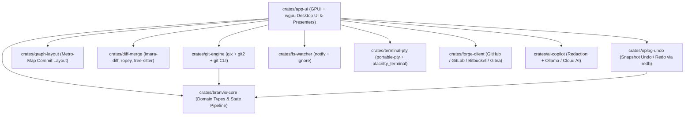

<p align="center">
  
</p>

<h1 align="center">Branvio</h1>

<p align="center">
  A native, fast and simple desktop Git client written in Rust.<br>
  Every Git command is one click away, and the risky ones ask first.
</p>

<p align="center">
  <a href="LICENSE-MIT"></a>
  
  
</p>

---

> **Status: pre-alpha.** The core engine is implemented across a modular Rust workspace, but Branvio has not had a public release yet. Expect rough edges and breaking changes.

## Highlights

- **Metro-map commit graph.** Branches are drawn as metro lines with stable colors, so `main`, release and feature lines are recognizable at a glance, even in large repositories.
- **The whole of Git, on screen.** Split buttons (Fetch, Pull, Push) expose every variant, right-click menus cover commits and branches, and the command palette reaches everything else.
- **Line-level staging.** Stage, unstage or discard individual lines and hunks, with syntax-aware context powered by `tree-sitter`, `ropey`, and `imara-diff`.
- **Three-way conflict editor.** Pick yours, theirs or both per conflict, or edit the result directly.
- **Undo that keeps your work.** Destructive operations (reset, discard, rebase, rollback) save an `oplog-undo` snapshot first, including untracked files, so Undo brings your work back.
- **Safe by default.** Force push uses a lease pinned to the remote state you saw when you confirmed. Hard resets, force pushes and destructive commands typed into Branvio's command box ask for confirmation, and Branvio asks before continuing when it cannot save an undo point.
- **Optional AI copilot.** Suggest commit messages and explain conflicts with a local model (Ollama) or a cloud provider (`openai`, `anthropic`, `gemini`). Secrets are masked and sensitive files are skipped before anything is sent, and cloud providers stay off until you allow them.
- **Native Git compatibility.** Uses your `.gitconfig`, SSH agent, GPG/SSH signing, Git LFS and hooks.
- **Integrated terminal, file watcher and forge support** (`terminal-pty`, `fs-watcher`, and GitHub, GitLab, Bitbucket, Gitea via `forge-client`).

## Getting started

### Requirements

| Dependency | Requirement |
|---|---|
| Rust | 1.95.0 (pinned in `rust-toolchain.toml`; `rustup` installs it automatically) |
| Git | 2.36 or newer on `PATH` |
| macOS | 12 or newer |
| Windows | 10 or newer (not yet tested on real hardware); building needs the MSVC toolchain and Windows SDK |
| Linux | X11 or Wayland, with graphics and font development packages for `gpui` |

### Build and run

```sh
git clone https://github.com/tranhoangtu-it/branvio.git
cd branvio
cargo run -p app-ui --release -- /path/to/a/repository
```

Without a path, Branvio opens the current directory.

### Run the checks

```sh
cargo fmt --all -- --check
cargo clippy --workspace --all-targets -- -D warnings
cargo test --workspace
```

To build and test without the GPU interface (for example on a CI server), use the headless configuration:

```sh
cargo test -p app-ui --no-default-features --features headless
```

## AI copilot (optional)

Cloud providers stay off until you allow them. Configure the copilot with environment variables:

| Variable | Meaning |
|---|---|
| `BRANVIO_AI_PROVIDER` | `ollama` (local), `openai`, `anthropic` or `gemini` |
| `BRANVIO_AI_BASE_URL` | Custom endpoint, for example a local Ollama server or a company proxy |
| `BRANVIO_AI_MODEL` | Model name, for example `qwen2.5-coder:14b` or `claude-sonnet-5-5` |
| `BRANVIO_AI_ALLOW_CLOUD_UPLOAD` | `1` to allow sending diffs to cloud providers for every repository |

You can also turn cloud uploads on for every repository from the command palette ("Toggle: Allow sending diffs to cloud AI"), or for a single repository from the prompt Branvio shows when a request is refused.

Before any request, `ai-copilot` removes diff sections for sensitive files (`.env`, keys, certificates, credentials) and masks secrets such as API keys, tokens, passwords and private keys. Provider API keys are read from the standard environment variables (`OPENAI_API_KEY`, `ANTHROPIC_API_KEY`, `GEMINI_API_KEY`) and are only sent to the provider's official endpoint.

## Architecture

Branvio is structured as a 10-crate Cargo workspace (`edition = "2024"`, `unsafe_code = "deny"`). The UI layer is isolated in `crates/app-ui`; all core Git, diffing, undo, forge, watcher, and AI crates remain UI-independent.



### Workspace Crates

| Crate | Responsibility |
|---|---|
| `branvio-core` | Domain types, compact IDs, paths, environment setup, lock-free state pipeline |
| `git-engine` | Three-tier Git access: `gix` for fast reads, `git2` for in-memory index work, the `git` CLI for write and network operations |
| `graph-layout` | Metro-line commit graph layout and deterministic branch colors |
| `diff-merge` | Diffs, word-level highlights, syntax context (`tree-sitter`), patch building, and three-way merge engine |
| `oplog-undo` | Transactional snapshot operation log (`redb`) for undo and redo |
| `fs-watcher` | Debounced filesystem watcher (`notify`) separating `.git` changes from working-tree changes |
| `terminal-pty` | Embedded cross-platform terminal (`portable-pty` + `alacritty_terminal`) |
| `forge-client` | GitHub, GitLab, Bitbucket and Gitea APIs, with tokens stored in OS keychain (`keyring`) |
| `ai-copilot` | Optional AI providers with secret masking and explicit cloud consent |
| `app-ui` | Presenter layer and native desktop interface built on `gpui` and `wgpu` |

More detail: [docs/ARCHITECTURE_PHASE1.md](docs/ARCHITECTURE_PHASE1.md), [design/ui-canvas](design/ui-canvas), and [assets/brand](assets/brand).

## Security

Please report vulnerabilities privately through [GitHub security advisories](https://github.com/tranhoangtu-it/branvio/security/advisories/new) rather than in a public issue.

## License

Branvio is dual-licensed under either of:

- [MIT license](LICENSE-MIT)
- [Apache License, Version 2.0](LICENSE-APACHE)

at your option. Third-party components and their licenses are listed in [THIRD_PARTY_NOTICES.md](THIRD_PARTY_NOTICES.md), with full license texts in [THIRD_PARTY_LICENSES.md](THIRD_PARTY_LICENSES.md).

Unless you explicitly state otherwise, any contribution you submit for inclusion in Branvio, as defined in the Apache-2.0 license, shall be dual-licensed as above, without any additional terms or conditions.
