# Branvio (`branvio`) — Bản Thiết Kế Kiến Trúc & Core Traits (Giai đoạn 1)

## 1. Triết lý Kiến trúc & Mục tiêu Phi chức năng

Branvio được thiết kế theo kiến trúc **Pure-Core / Decoupled-UI** với 3 nguyên tắc bất biến:
1. **Zero UI-Thread Blocking (60–120 FPS):** Luồng giao diện (`gpui` + `wgpu`) không bao giờ chạm trực tiếp vào filesystem, `gix`, `git2`, hoặc `git` CLI; mọi thao tác đọc chỉ tiêu tốn ~2ns thông qua `ArcSwap<RepoViewSnapshot>` không khóa (`wait-free`).
2. **UI-Swappable Boundary:** Toàn bộ 9 core crates (`branvio-core`, `git-engine`, `graph-layout`, `diff-merge`, `oplog-undo`, `fs-watcher`, `terminal-pty`, `forge-client`, `ai-copilot`) tuyệt đối không phụ thuộc bất kỳ crate giao diện nào. Tầng `app-ui` giao tiếp qua port `UiRuntimeBackend` + `CoreAppHost` + `UiWakeupSink`, cho phép thay thế `gpui` bằng `Iced` hoặc `Tauri v2` mà không sửa bất kỳ dòng code nào ở Core.
3. **100% Native Git Ecosystem Compatibility:** Bảo toàn tuyệt đối `.gitconfig`, SSH Agent (`SSH_AUTH_SOCK`, Windows OpenSSH Named Pipe `\\.\pipe\openssh-ssh-agent`, Pageant, 1Password), GPG/SSH Commit Signing, Git LFS, và các Git Hooks (`husky`, `pre-commit`, `commit-msg`, `pre-push`).

---

## 2. Chiến lược 3-Tier Hybrid Git Engine

| Tier | Thư viện / Công cụ | Phạm vi trách nhiệm | Lý do kỹ thuật & An toàn đồng thời |
| :--- | :--- | :--- | :--- |
| **Tier 1** | `gix` (`gitoxide`) | Đọc ODB bất đồng bộ, **Stateful `RevwalkSession` topo**, blame, refs (`RefsSnapshot` kèm `RefBadgeMap`), working-tree status (`GIT_OPTIONAL_LOCKS=0`), mailmap, gitattributes. | Zero-lock memory-mapped packfile reading, hợp tác hủy qua `CancelToken` (`&AtomicBool`), giữ walker frontier có trạng thái giữa các chunk thay vì walk lại từ đầu. |
| **Tier 2** | `git2` (`default-features = false`) | Stage/Unstage toàn file hoặc từng dòng/hunk in-memory trên `.git/index`, snapshot/restore tree OID cho `oplog-undo`, `merge_commits` dự báo xung đột trong RAM trước khi kéo-thả. | `git2::Repository` không `Sync` và thao tác ghi luôn khóa `.git/index.lock`; mọi hàm `GitIndexEngine` đều `async` chạy trên `tokio::task::spawn_blocking` và ánh xạ tranh chấp lock sang `GitEngineError::IndexLocked`. Tắt `default-features` loại bỏ `libssh2`/`openssl`. |
| **Tier 3** | System `git` CLI (`tokio::process`) | Mọi lệnh ghi lịch sử & mạng (`commit`, `merge`, `rebase`, `rebase -i` qua `GIT_SEQUENCE_EDITOR`, `cherry-pick`, `revert`, `reset`, `fetch`, `pull`, `push`, `stash`, `worktree`) và **Pickaxe Search** (`git log -S` / `-G`). | Thực thi chuẩn 100% Hooks, LFS, Credential Helpers, SSH Agents; chèn `--end-of-options` (via `build_safe_revision_args`) chống flag injection từ tên nhánh bắt đầu bằng `-`, kèm `GIT_TERMINAL_PROMPT=0` và `LC_ALL=C` khi parse output. |

---

## 3. Số đo `std::mem::size_of` Thực tế & Ngân sách RAM (>100.000 Commits)

Mục tiêu: **< 80 MB RAM ở trạng thái idle** và **< 300 MB RAM khi mở monorepo > 100.000 commits**.

Các kích thước dưới đây được đo trực tiếp bằng `std::mem::size_of` trên `rustc 1.95.0` (64-bit) trong unit test `compact_graph_types_meet_memory_budget`:

| Kiểu dữ liệu | Kích thước thực đo (Bytes) | 100.000 bản ghi (MB) | Thiết kế nén bộ nhớ |
| :--- | :---: | :---: | :--- |
| `GitOid` | **33 B** | — | Stack-allocated `[u8; 32]` + `ObjectFormat` (1 B), `Copy`, 0 heap allocation. |
| `CommitNode` | **336 B** | **~33,6 MB** | `parents: SmallVec<[GitOid; 2]>`, `CompactString`, `flags: CommitFlags` (1 B). `full_message`/`changed_files` lazy-load vào `CommitDetails`. |
| `GraphRow` | **152 B** | **~15,2 MB** | Loại bỏ `row_index`, tách `RefBadge` ra `RefBadgeMap` thưa, mã hóa màu bằng `palette_slot: u8`, inline 2 `GraphEdge` mỗi chiều. *(Giảm từ 696 B xuống 152 B — gọn hơn 4,58x).* |
| `GraphEdge` | **12 B** | — | Thay `GitOid` + `DeterministicColor` bằng `target_row: u32` (`UNRESOLVED_COMMIT_ROW` khi chưa tải tới) + `palette_slot: u8`. |
| `LaneSegment` | **4 B** | — | `lane_index: u16` + `palette_slot: u8` + `is_dotted_wip: bool`. |
| `GraphNodeKind` | **4 B** | — | Đưa WIP ra khỏi enum để thu gọn tag + payload xuống 4 bytes. |
| `VirtualWipRow` | **120 B** | **0,0001 MB** | Tách rời ngoài `Vec<GraphRow>`; chỉ có tối đa 1 bản ghi khi working tree bẩn. |
| `RefBadge` | **88 B** | **~0,1–1,0 MB** | Nằm trong `RefBadgeMap` (`HashMap<GitOid, SmallVec<[RefBadge; 2]>>`); commit không có branch/tag tốn **0 bytes**. |

- **Tổng bộ nhớ graph + commit cho 100.000 commits:** `33,6 + 15,2 + ~1 ≈ 49,8 MB`.
- **Cộng cache packfile của `gix` (~64–96 MB):** Tổng ước tính **~114–146 MB**, giữ biên an toàn rộng (>150 MB dự phòng) dưới trần 300 MB.
- **Diff & 3-Way Merge:** `FileDiffPatch::backing_text: Arc<str>` chia sẻ 1 buffer cho hàng chục nghìn dòng (`DiffLine` chỉ giữ `ByteRange` 8 B); 3-Way Merge dùng 4 `ropey::Rope` ($O(\log N)$).

---

## 4. Quy chuẩn Topology, Detached WIP & Màu Làn Ẩn danh

1. **Thứ tự Topo Nghiêm ngặt (Chống Clock Skew):**
   - `RevwalkSession::next_chunk` bắt buộc xuất commit theo thứ tự topo **con luôn đứng trước mọi cha** (*parent-after-child*), không phụ thuộc committer timestamp khi có lệch đồng hồ hệ thống (*clock skew*). Timestamp chỉ làm tie-breaker giữa các node đã đủ điều kiện topo.
   - `IncrementalLayoutSession::push_commits_chunk` kiểm tra bất biến topo và hỗ trợ bộ test cho: *octopus merge*, *criss-cross merge*, *orphan branches*, và *clock skew*.
2. **Detached `VirtualWipRow` (`O(1)` Viewport Mapping):**
   - `VirtualWipRow` lưu tách biệt khỏi `commit_rows` trong `GraphSnapshotView` và `IncrementalLayoutSession`.
   - `display_row_count()`, `display_to_commit_index()`, và `commit_to_display_index()` ánh xạ theo offset `+1` trong $O(1)$ mà không dịch chuyển mảng hay làm sai lệch `GraphEdge::target_row`.
3. **Quy tắc màu cho làn ẩn danh (`deterministic_anonymous_lane_color`):**
   - Khi một làn mới mở ra từ **cha thứ hai trở đi của merge** mà không có `RefBadge` trỏ trực tiếp vào commit cha đó, màu làn được tính thuần túy bằng FNV-1a trên `parent_oid.as_bytes()` ánh xạ vào `METRO_PALETTE[4..16]` (`slots 4..=15`) — hoàn toàn tất định và không phụ thuộc nội dung commit message.

---

## 5. Luồng Dữ liệu Bất Đồng Bộ & Chống Race Condition (MVCC Pipeline)

```mermaid
flowchart LR
    FS["fs-watcher<br/>Dual-Stream (.git + ignore worktree)<br/>Adaptive Storm Debouncer"] -->|DirtyScopeFlags| CTRL["InternalOpController<br/>Suppression Lease"]
    CTRL -->|Next RepoEpoch + CancelToken| GIT["git-engine<br/>Tier 1 (gix RevwalkSession) & Tier 2 (git2)"]
    GIT -->|Strict Topo RevwalkChunk + RefBadgeMap| DAG["graph-layout<br/>Metro-line DAG + Detached WIP"]
    DAG -->|Arc&lt;RepoViewSnapshot&gt;| MVCC["MvccRepoStateStore<br/>Atomic CAS: candidate.epoch > committed_epoch"]
    MVCC -->|UiWakeupSink notify| UI["app-ui (120 FPS gpui + wgpu)<br/>Wait-free ArcSwap::load_full()"]
```

1. **Lọc lockfile & phân luồng tại `fs-watcher`:** `classify_repo_event_path` loại bỏ tức thì `.git/*.lock` và `.DS_Store`. Sự kiện `.git/` dùng debounce nhanh (`35ms`); worktree dùng bộ lọc `ignore` và debounce `120ms`, tự động giãn thành `650ms` khi vượt `150 sự kiện / cửa sổ`.
2. **Khóa dập bão nội bộ (`InternalOpLease`):** Khi Branvio thực thi lệnh Tier 3 (`rebase`, `checkout`, `stash pop`), nó giữ `InternalOpLease` để gom mọi sự kiện trung gian thành **1 lần refresh nguyên tử** khi lệnh kết thúc.
3. **Chống Race Condition bằng `RepoEpoch` + `CancelToken`:** Mỗi lượt refresh được cấp `RepoEpoch` tăng đơn điệu; `CancelToken` hủy sớm tác vụ cũ và `MvccRepoStateStore::try_publish` dùng `compare_exchange_weak` chỉ công bố khi `candidate.epoch > committed_epoch`.

---

## 6. Xử lý Cross-Platform Edge Cases (Windows / macOS / Linux)

| Lĩnh vực | macOS | Windows | Linux |
| :--- | :--- | :--- | :--- |
| **Đường dẫn & Case-sensitivity** | Chuẩn hóa `/` <-> `HostPath` via `dunce`; `FsCaseSensitivity::detect` nhận diện APFS case-insensitive cho lệnh đổi tên `Foo.rs -> foo.rs`. | Tự động gắn tiền tố `\\?\` / `\\?\UNC\` khi UTF-16 length `>= 248` (`MAX_PATH` guard); `for_external_cli()` rút gọn về path chuẩn cho hooks. | Phân biệt hoa-thường chuẩn POSIX (`CaseSensitive`), hỗ trợ symlink/gitlink trực tiếp. |
| **SSH Agent & Auth** | Đọc `$SHELL -lic "env -0"` off-thread (timeout 800ms) khi app mở từ Dock để thu thập `SSH_AUTH_SOCK` (1Password, Secretive, OpenSSH) & `/opt/homebrew/bin`. | Hỗ trợ `SSH_AUTH_SOCK` lẫn Windows OpenSSH Named Pipe (`\\.\pipe\openssh-ssh-agent`), Pageant và Git Credential Manager. | Kế thừa `SSH_AUTH_SOCK`, `GPG_TTY`, `XDG_RUNTIME_DIR` và Secret Service Keyring. |
| **HiDPI & Keymap** | `Cmd` (`⌘`) làm primary modifier; Retina scaling `2.0x` qua `DisplayScalePolicy::hairline_logical_px`. | `Ctrl` làm primary modifier; hỗ trợ fractional DPI (`1.25x`, `1.5x`, `2.0x`). | `Ctrl` làm primary modifier; hỗ trợ cả Wayland lẫn X11 thông qua `gpui`. |
